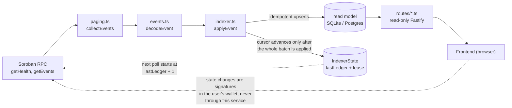

# Architecture

How an event on the Stellar ledger becomes a row in the database and a
response from the API. Read this before changing anything under
`src/stellar/`; the procedures that pair with it live in
[RUNBOOK.md](RUNBOOK.md).

## The pipeline

One process runs the API and the indexer together by default
(`src/index.ts`). `npm run start:api` and `npm run start:indexer` split them
for deployments that need different scaling; the split changes nothing
about the pipeline below.

### 1. Poll

`Indexer.cycle()` runs every `INDEXER_POLL_MS` (default 5000; a cycle that
hit its page budget runs again immediately). Each cycle:

1. Renews — or takes — the cursor lease (see [The cursor and the
   lease](#the-cursor-and-the-lease)).
2. Reads the cursor: `IndexerState.lastLedger` on the single row `id = 1`.
3. Asks RPC for `getHealth()` and compares:
   - `lastLedger + 1` older than `oldestLedger` means the indexer has
     fallen outside the RPC retention window. It sets `gap = true` with the
     cursor and the oldest available ledger, stops advancing, and `/ready`
     returns 503. Recovery is in [RUNBOOK.md](RUNBOOK.md).
   - `lastLedger + 1` newer than `latestLedger` means it is caught up;
     nothing to do this cycle.

### 2. Page

`collectEvents()` (`src/stellar/paging.ts`) reads `getEvents` from
`lastLedger + 1`, following the RPC's opaque cursor across pages: 200
events per page, at most 50 pages per cycle.

- A short page means the range is drained; `throughLedger = latestLedger`.
- If the page budget runs out first, the last (possibly split) ledger is
  deliberately excluded from the result and `throughLedger` stops just
  before it. The next cycle re-reads that ledger in full rather than
  applying half of it and losing the rest.

### 3. Decode

`decodeEvent()` (`src/stellar/events.ts`) turns raw ScVals into a map of
named fields. The trap this repository documents everywhere: fields marked
`#[topic]` in the Rust event struct arrive in the event's **topic list**,
not in its data map, and `TOPIC_FIELDS` is what restores their names
positionally. A field moving between topic and data is a breaking change to
this decoder and to `TOPIC_FIELDS`, which must be kept in step with the
contracts in the same change.

Both base64 XDR strings and already-parsed ScVals are accepted, because the
RPC response shape has varied across SDK versions.

### 4. Apply

`applyEvent()` (`src/stellar/indexer.ts`) switches on the event name and
dispatches to a handler. The rules every handler keeps:

- **Upserts only.** Every write is an upsert keyed by the on-chain event id
  (`e.id`) — or, for head state, the natural key. Replay is normal, not
  exceptional.
- **Related rows commit together** (`$transaction`), so the read model
  cannot disagree with itself mid-apply.
- **Only meaningful changes become history.** A service upsert writes a
  price-history row only when the price actually changed, not on a
  relabelling.
- **One malformed event cannot wedge the pipeline.** A handler failure is
  logged with the event name, transaction hash and ledger, and that event
  is skipped; the rest of the batch still applies. The hash and ledger are
  what make a skipped event reproducible.
- **Unknown event names are warned once per process** — a contract upgrade
  that starts emitting something new is visible without log spam. Events
  that are known but deliberately not projected (for example
  `dispute_resolved`) are listed in `IGNORED_EVENTS` and stay silent.

### 5. Advance the cursor

Only after every event in the batch has been applied (or deliberately
skipped) is `lastLedger` moved to `throughLedger`. A crash before that line
replays the batch on restart — which is safe because handlers are
idempotent — rather than skipping it.

## The cursor and the lease

The database is a projection, which makes the cursor the one value in it
that cannot be recomputed: how far the ledger has been consumed.
`IndexerState` is a single row holding that cursor plus a lease.

- **Single writer.** Any number of indexer processes may run; exactly one
  holds the lease and advances the cursor. Standbys log that they are
  standing by and retry each cycle.
- **Acquire, refresh, release.** Acquisition is one conditional `UPDATE`
  (`WHERE leaseOwner IS NULL OR leaseExpiresAt <= now OR leaseOwner = me`),
  which both SQLite and Postgres execute atomically, so two instances
  cannot both win the same lease. The TTL is 60 seconds and is refreshed
  every cycle; graceful shutdown releases it so a standby takes over
  immediately.
- **Why not a database advisory lock.** This exact code path also runs on
  the SQLite database used in development and tests, and a session-scoped
  lock behaves badly under connection pooling.

Two writers advancing one cursor from stale reads can silently skip events
— idempotent handlers do not help, because the skipped events never reach a
handler at all. That is the race the lease exists to prevent.

`npm run indexer:backfill -- --from <ledger>` replays events **without
touching the cursor**; it is the supported way to repair history.

## Failure modes

| Failure | What happens | What to do |
| --- | --- | --- |
| RPC unreachable | Cycle fails, logged; cursor unchanged; retried next cycle | Wait; `/ready` shows the `rpc` check failing. Persistent → check `SOROBAN_RPC_URL` |
| Cursor outside the RPC retention window | `gap` set, cursor frozen, `/ready` 503 naming the gap | [RUNBOOK.md](RUNBOOK.md) — snapshot, accepted gap, or reindex |
| Malformed event | Skipped with transaction hash and ledger logged; batch continues | Investigate with the hash; backfill if it mattered |
| Crash mid-batch | Cursor not advanced; batch replays on restart | Nothing — replay is safe by design |
| Two instances running | Lease keeps one active; the other logs standby | Nothing |
| Lease holder dies | A standby takes the lease after the 60-second TTL | Nothing |
| Database unreachable | Cycle fails; `/ready` 503 with the `database` check failing | Check the database and `DATABASE_URL` |
| Contract upgrade emits a new event name | Warned once, event ignored | Add a case to `applyEvent`, and a `TOPIC_FIELDS` entry if it has topics |

## Changing the indexer

- **A new event to project** needs: a `TOPIC_FIELDS` entry (topic field
  names in declaration order), a case in `applyEvent`, whatever Prisma
  model the read model needs, and tests in `src/__tests__/events.test.ts`
  and `indexer.test.ts`.
- **A new read endpoint** lives in `src/routes/`, registered in
  `src/app.ts`. Amounts stay decimal strings; see the API section of the
  README.
- **Nothing that changes the cursor discipline** — advancing before the
  batch applies, adding a second writer, editing the lease conditions —
  is safe without revisiting this document and the tests around
  `src/stellar/lease.ts`.
