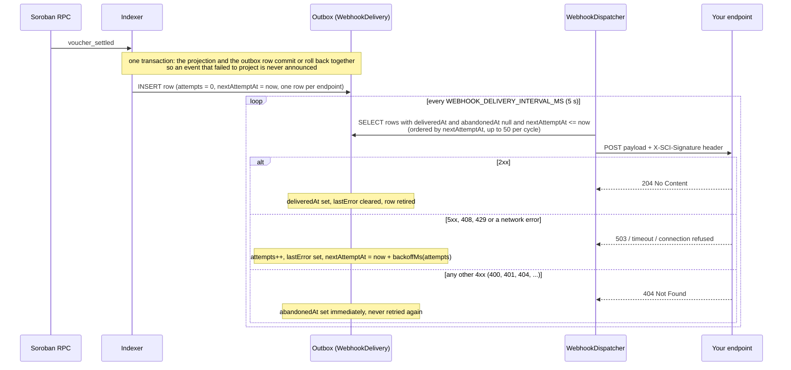

# Webhooks

How voucher events are delivered to a clinic endpoint: the outbox, the retry schedule, and what a receiver has to be able to assume.

[Back to the README](../README.md).

Set `WEBHOOK_URLS` to a comma-separated list of endpoints and `WEBHOOK_SECRET`
to sign every delivery. When a voucher-related event is projected, the backend
writes a row to a delivery outbox in the same transaction, then posts it from a
separate loop — a slow or unreachable endpoint therefore never stalls the
indexer. Failed deliveries retry with exponential backoff (five seconds
doubling, capped at ten minutes) and are given up on after six attempts or a
permanent 4xx response.

## Delivery sequence



The outbox row is written inside the same transaction as the projection it
describes, and the dispatcher is a separate loop that wakes every
`WEBHOOK_DELIVERY_INTERVAL_MS` (5 s): a slow or dead endpoint can therefore
never stall the indexer, and a rolled-back projection never sends a
notification.

## Retry schedule

Numbers from `src/lib/webhooks.ts`: `WEBHOOK_BASE_BACKOFF_MS = 5_000`,
`WEBHOOK_MAX_BACKOFF_MS = 600_000` (ten minutes),
`WEBHOOK_MAX_ATTEMPTS = 6`, `WEBHOOK_DELIVERY_INTERVAL_MS = 5_000`. The
delay after a failed attempt is `backoffMs(attempt)` = base doubled once per
attempt, capped at ten minutes; because the dispatcher only looks for due
rows every five seconds, the actual retry lands between the backoff and the
backoff plus one poll.

| Failed attempt | Backoff (`backoffMs`) | Retry starts between | Outcome of that attempt |
| --- | --- | --- | --- |
| 1 | 5 s (`5000` ms) | 5 s and 10 s later | retried |
| 2 | 10 s (`10000` ms) | 10 s and 15 s later | retried |
| 3 | 20 s (`20000` ms) | 20 s and 25 s later | retried |
| 4 | 40 s (`40000` ms) | 40 s and 45 s later | retried |
| 5 | 80 s (`80000` ms) | 80 s and 85 s later | retried |
| 6 | n/a | n/a | **abandoned** (`attempts >= WEBHOOK_MAX_ATTEMPTS`) |

With six attempts the largest delay ever reached is 80 s, so the ten-minute
cap only matters for callers that raise `WEBHOOK_MAX_ATTEMPTS`. A permanent
response (any 4xx other than 408 and 429) skips the remaining attempts and
abandons the row on the spot: a 404 will not become a 204 by waiting.

## What a receiver must assume

- **At-least-once.** A delivery that succeeds after the receiver processed
  it but before the row was marked (a timeout, a crash between the response
  and the commit) is retried. Deduplicate on `(event, voucherId)`, or treat
  a repeated notification as a no-op; handlers should be idempotent anyway.
- **No cross-event ordering.** Rows are enqueued in ledger order, but a
  failing row backs off while newer rows keep flowing, so a receiver can see
  `voucher_settled` before the `voucher_claimed` retry that precedes it.
  `ledger` in the payload is the ordering key when order matters.
- **Independent endpoints.** Every configured URL gets its own row and its
  own backoff: one dead clinic endpoint never delays another's deliveries.
- **The receiver is the only witness to its own downtime.** The sender only
  knows the HTTP response it got; a 5xx is retried, a 2xx is final, and
  nothing is re-sent once `deliveredAt` or `abandonedAt` is set. There is no
  replay command, so a receiver that lost deliveries should read the state
  from the API (for example `GET /vouchers/:id/events`) rather than wait.
A backlog is visible instead of silent. `GET /ready` reports
`checks.webhooks` — `state` (`ok`, `backlog` or `disabled`), `pending`,
`abandoned`, `oldestPendingAgeSeconds` and `maxPendingAgeSeconds` — and
answers 503 once a delivery has been pending longer than
`READY_WEBHOOK_MAX_AGE_MS` (default fifteen minutes), because a healthy loop
drains every retry far sooner than that. `/metrics` exposes the same counts
as `webhook_deliveries_pending` and `webhook_deliveries_abandoned`, which is
what the `SciWebhookBacklog` rule in `ops/alerts.yml` watches. Abandoned
rows are never retried: those clinics missed those events, which is why the
count is reported separately rather than folded into the log.

Each request is `POST` with a JSON body and an `X-SCI-Signature` header holding
the hex HMAC-SHA256 of the **raw request body** under `WEBHOOK_SECRET`:

```json
{
  "event": "voucher_settled",
  "voucherId": "42",
  "status": "Settled",
  "txHash": "deadbeef...",
  "ledger": 123456
}
```

`txHash` is omitted when the RPC did not report one. The payload never contains
a beneficiary reference, so a webhook receiver learns that *a* voucher moved,
never who it was for.

Verify a delivery by recomputing the signature over the exact bytes received —
do not parse and re-serialise the JSON first, as that can change the bytes:

```ts
import { createHmac, timingSafeEqual } from 'node:crypto';

app.post('/webhooks/sci', (req, res) => {
  const received = req.header('x-sci-signature') ?? '';
  const expected = createHmac('sha256', process.env.WEBHOOK_SECRET!)
    .update(req.rawBody) // the raw body buffer, not a re-encoded object
    .digest('hex');

  const ok =
    received.length === expected.length &&
    timingSafeEqual(Buffer.from(received), Buffer.from(expected));
  if (!ok) return res.sendStatus(401);

  // Only now trust the body.
  res.sendStatus(204);
});
```
