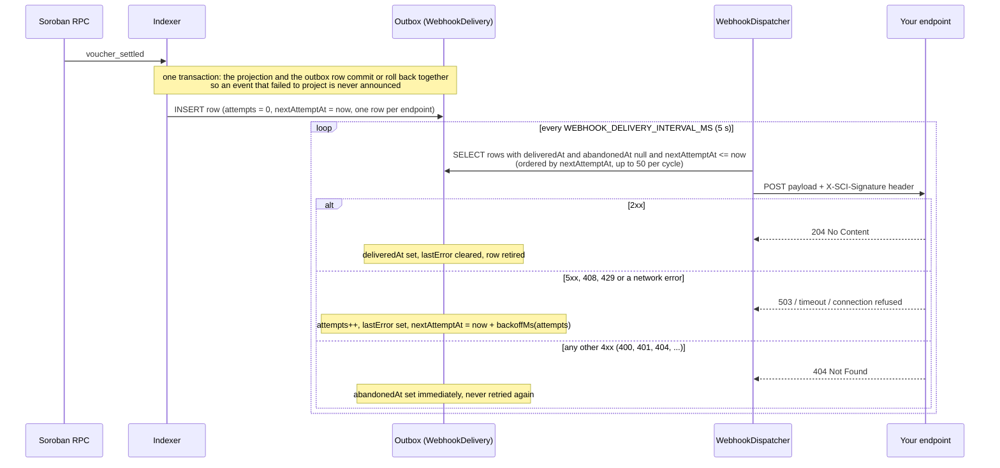

# Webhooks

How voucher events are delivered to a clinic endpoint: the outbox, the retry schedule, and what a receiver has to be able to assume.

[Back to the README](../README.md).

Set `WEBHOOK_URLS` to a comma-separated list of endpoints and `WEBHOOK_SECRET`
to sign every delivery. When a voucher-related event is projected, the backend
writes a row to a delivery outbox in the same transaction, then posts it from a
separate loop — a slow or unreachable endpoint therefore never stalls the
indexer. Failed deliveries retry with exponential backoff (five seconds
doubling, capped at ten minutes) and are given up on after six attempts or a
permanent 4xx response. An endpoint that keeps failing is paused by a
per-endpoint circuit breaker rather than retried for every event (#265).

Events are emitted for voucher transitions and, since #266, for clinic and
service changes: `provider.registered`, `provider.status_changed` and
`service.price_changed`.

## Delivery sequence



The outbox row is written inside the same transaction as the projection it
describes, and the dispatcher is a separate loop that wakes every
`WEBHOOK_DELIVERY_INTERVAL_MS` (5 s): a slow or dead endpoint can therefore
never stall the indexer, and a rolled-back projection never sends a
notification.

## Retry schedule

Numbers from `src/lib/webhooks.ts`: `WEBHOOK_BASE_BACKOFF_MS = 5_000`,
`WEBHOOK_MAX_BACKOFF_MS = 600_000` (ten minutes),
`WEBHOOK_MAX_ATTEMPTS = 6`, `WEBHOOK_DELIVERY_INTERVAL_MS = 5_000`. The
delay after a failed attempt is `backoffMs(attempt)` = base doubled once per
attempt, capped at ten minutes; because the dispatcher only looks for due
rows every five seconds, the actual retry lands between the backoff and the
backoff plus one poll.

| Failed attempt | Backoff (`backoffMs`) | Retry starts between | Outcome of that attempt |
| --- | --- | --- | --- |
| 1 | 5 s (`5000` ms) | 5 s and 10 s later | retried |
| 2 | 10 s (`10000` ms) | 10 s and 15 s later | retried |
| 3 | 20 s (`20000` ms) | 20 s and 25 s later | retried |
| 4 | 40 s (`40000` ms) | 40 s and 45 s later | retried |
| 5 | 80 s (`80000` ms) | 80 s and 85 s later | retried |
| 6 | n/a | n/a | **abandoned** (`attempts >= WEBHOOK_MAX_ATTEMPTS`) |

With six attempts the largest delay ever reached is 80 s, so the ten-minute
cap only matters for callers that raise `WEBHOOK_MAX_ATTEMPTS`. A permanent
response (any 4xx other than 408 and 429) skips the remaining attempts and
abandons the row on the spot: a 404 will not become a 204 by waiting.

## Endpoint circuit breaker

Numbers from `src/lib/webhooks.ts`: `WEBHOOK_BREAKER_FAILURE_THRESHOLD = 5`
consecutive failed deliveries, then `WEBHOOK_BREAKER_COOLDOWN_MS = 30000`
(thirty seconds) before one probe is allowed through.

While an endpoint's breaker is **open**, its deliveries are not retried:
the dispatcher does not even select them, their `attempts` counter is left
alone, and the rows stay queued. Other configured endpoints keep delivering
normally — the held rows never consume the 50-row batch. After the cooldown
the breaker is **half-open**: exactly one probe, the oldest held row, is
sent. If it succeeds the breaker closes and the remaining held rows go out
in their original order, oldest first. If the probe fails the breaker opens
again for another cooldown.

Only network errors, 5xx, 408 and 429 count as breaker failures — they mean
the endpoint is not answering. A permanent 4xx proves the endpoint is up and
only abandons that one delivery. The breaker is in-memory: a restart starts
closed, which is correct for a process that has not yet observed a failure.

`/ready` reports every endpoint the dispatcher has seen in
`checks.webhooks.breakers`, each as `{ endpoint, state, consecutiveFailures,
openedAt }` where `state` is `closed`, `open` or `half-open` and `endpoint`
is the origin and path with any query string removed. A tripped breaker is
reported but does not make the instance unready: the deliveries are held,
not lost. The same state is on `/metrics` as `webhook_circuit_state`
(0 closed, 1 half-open, 2 open) and
`webhook_circuit_consecutive_failures`, both labelled by `endpoint`.

## Registry and service events

In addition to the voucher events above, three registry events are delivered
with the same signature, outbox, retry and breaker behaviour (#266):

```json
{
  "event": "provider.registered",
  "provider": "G...",
  "status": "Pending",
  "txHash": "deadbeef...",
  "ledger": 123456
}
```

```json
{
  "event": "provider.status_changed",
  "provider": "G...",
  "status": "Suspended",
  "txHash": "deadbeef...",
  "ledger": 123456
}
```

```json
{
  "event": "service.price_changed",
  "provider": "G...",
  "serviceCode": 101,
  "price": "30000000",
  "txHash": "deadbeef...",
  "ledger": 123456
}
```

`price` is the exact base-unit amount as a decimal string, the same form the
API returns, never a float. A first listing counts as a price change. A
`provider.status_changed` is sent only when the status actually differs from
the indexed row, so replaying an event does not notify twice. Voucher payloads
are unchanged by this: a receiver that only understands voucher events sees
exactly the body it saw before.

## Testing an endpoint

```sh
npm run webhooks:ping -- --url https://clinic.example/webhooks
# or, with the secret supplied explicitly
npm run webhooks:ping -- --url https://clinic.example/webhooks --secret "$WEBHOOK_SECRET"
```

`--secret` defaults to `WEBHOOK_SECRET`. The command sends
`{"event":"ping","sentAt":"..."}` with the same raw-body HMAC-SHA256 in
`x-sci-signature` as a real delivery, prints the HTTP status and latency, and
exits non-zero when the answer is not 2xx or the request fails. Usage errors
exit 2. The production script runs the compiled `dist/` entry point; use
`npm run webhooks:ping:dev` to run it from source without a build.

## Tracing

When tracing is configured (`OTEL_EXPORTER_OTLP_ENDPOINT` set), every delivery
attempt is a `webhook.deliver` span with the `webhook.event`,
`webhook.endpoint` (origin and path, query string removed) and
`webhook.attempt` attributes, and the request carries a W3C `traceparent`
header so a receiver can join the delivery to the indexer cycle or request
that produced it (#268). The payload is never copied into a span attribute,
and with tracing off no span is exported and no `traceparent` header is sent.

## What a receiver must assume

- **At-least-once.** A delivery that succeeds after the receiver processed
  it but before the row was marked (a timeout, a crash between the response
  and the commit) is retried. Deduplicate on `(event, voucherId)`, or treat
  a repeated notification as a no-op; handlers should be idempotent anyway.
- **No cross-event ordering.** Rows are enqueued in ledger order, but a
  failing row backs off while newer rows keep flowing, so a receiver can see
  `voucher_settled` before the `voucher_claimed` retry that precedes it.
  `ledger` in the payload is the ordering key when order matters.
- **Independent endpoints.** Every configured URL gets its own row and its
  own backoff: one dead clinic endpoint never delays another's deliveries.
- **The receiver is the only witness to its own downtime.** The sender only
  knows the HTTP response it got; a 5xx is retried, a 2xx is final, and
  nothing is re-sent once `deliveredAt` or `abandonedAt` is set. There is no
  replay command, so a receiver that lost deliveries should read the state
  from the API (for example `GET /vouchers/:id/events`) rather than wait.
A backlog is visible instead of silent. `GET /ready` reports
`checks.webhooks` — `state` (`ok`, `backlog` or `disabled`), `pending`,
`abandoned`, `oldestPendingAgeSeconds` and `maxPendingAgeSeconds` — and
answers 503 once a delivery has been pending longer than
`READY_WEBHOOK_MAX_AGE_MS` (default fifteen minutes), because a healthy loop
drains every retry far sooner than that. `/metrics` exposes the same counts
as `webhook_deliveries_pending` and `webhook_deliveries_abandoned`, which is
what the `SciWebhookBacklog` rule in `ops/alerts.yml` watches. Abandoned
rows are never retried: those clinics missed those events, which is why the
count is reported separately rather than folded into the log.

Each request is `POST` with a JSON body and an `X-SCI-Signature` header holding
the hex HMAC-SHA256 of the **raw request body** under `WEBHOOK_SECRET`:

```json
{
  "event": "voucher_settled",
  "voucherId": "42",
  "status": "Settled",
  "txHash": "deadbeef...",
  "ledger": 123456
}
```

`txHash` is omitted when the RPC did not report one. The payload never contains
a beneficiary reference, so a webhook receiver learns that *a* voucher moved,
never who it was for.

Verify a delivery by recomputing the signature over the exact bytes received —
do not parse and re-serialise the JSON first, as that can change the bytes:

```ts
import { createHmac, timingSafeEqual } from 'node:crypto';

app.post('/webhooks/sci', (req, res) => {
  const received = req.header('x-sci-signature') ?? '';
  const expected = createHmac('sha256', process.env.WEBHOOK_SECRET!)
    .update(req.rawBody) // the raw body buffer, not a re-encoded object
    .digest('hex');

  const ok =
    received.length === expected.length &&
    timingSafeEqual(Buffer.from(received), Buffer.from(expected));
  if (!ok) return res.sendStatus(401);

  // Only now trust the body.
  res.sendStatus(204);
});
```
